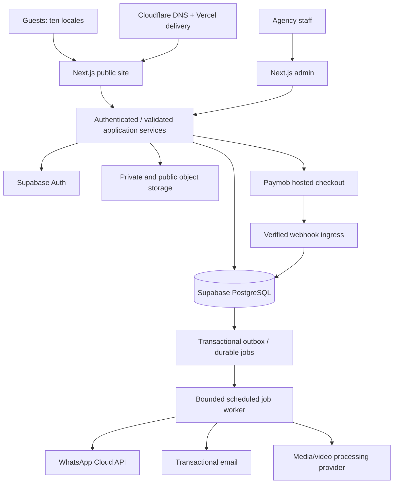

# Egyptian Red Sea Tourism Platform — Codex Production Handoff

> **For Codex / agentic workers:** Implement this project, not another plan or a static mockup. Work through the milestones and acceptance gates below. Use installed Superpowers execution, testing, debugging and review skills where available; otherwise follow the equivalent test-first workflow in this document. Do not stop after scaffolding, generating the homepage, or writing deployment instructions.

**Goal:** Build, test and deploy a multilingual tourism agency platform with manually approved reservations, flexible payments, agency-managed apartments, and public/private underwater photography.

**Architecture:** A modular Next.js application, PostgreSQL/Supabase, private/public object storage and durable background jobs. PostgreSQL owns inventory, booking state and financial records. External providers handle checkout, WhatsApp, email and video processing.

**Tech stack:** Next.js App Router, React, TypeScript, Tailwind CSS, next-intl, Supabase PostgreSQL/Auth/Storage, Paymob, WhatsApp Cloud API, transactional email, Playwright Test, Playwright Agent CLI, Vitest, pgTAP or equivalent database tests, GitHub Actions and Vercel on a commercially permitted plan.

**Specification:** This file is the self-contained specification and implementation plan. No previous chat is required. `DESIGN.md`, if supplied in the same package, adds the initial visual direction; this file remains authoritative for behavior and launch criteria.

**Prepared:** 2026-10-20. External tool instructions were checked against the linked upstream documentation. Re-check versions and security advisories at execution time. The handoff itself is not evidence that the application is built or deployed.

---

## 0. Execution contract

### 0.1 Begin with the current workspace

1. Inspect the current directory, repository status, existing `AGENTS.md`, package manifests, lockfiles, environment examples, migrations and documentation.
2. Preserve existing work. Never run destructive cleanup, `git reset --hard`, overwrite user changes, or connect this project to an unrelated repository.
3. No tourism brand name, production domain, repository URL or local path has been chosen. Use `red-sea-tourism` only as an internal project slug. Do not reuse the Hamyx company website or any other client repository automatically.
4. In an empty workspace, initialize the application here. If a scaffolder refuses because the handoff files exist, scaffold in a temporary sibling directory and carefully merge the generated files; do not delete the handoff.
5. Create `PROJECT_STATUS.md`, `docs/DECISIONS.md`, `docs/BLOCKERS.md`, `docs/REQUIREMENTS_TRACEABILITY.md` and `docs/TOOLCHAIN_LOCK.md` before substantial implementation.
6. Use one package manager. Default to npm and commit `package-lock.json`; respect an existing coherent package-manager choice.
7. Resolve supported, patched framework/runtime versions, verify their compatibility, pin dependencies, and record exact versions. Do not put floating `latest` versions into production manifests.
8. Establish an isolated branch/worktree when appropriate. Do not assume permission to push to an unidentified remote.

### 0.2 Work independently, but respect real launch dependencies

The product decisions below are already approved. Do not repeatedly ask the owner to choose the approval model, payment policies, languages, apartment ownership model or photography model.

Choose sensible reversible implementation details and record them. Continue on independent modules when an external provider, credential, asset or business approval is missing. Use clearly marked local/staging adapters, fixtures and allowlisted recipients. Never make a production screen pretend that a fake payment, message, booking, review or integration is real.

Ask only for information or authorization necessary for a genuinely blocked external action. Do not purchase subscriptions, initiate real money movement, change unrelated DNS, disable security controls, or publish unapproved business claims. Once the owner-designated production accounts, domain, secrets and approved content are available, perform the deployment and verify it; do not hand back instructions instead of executing an authorized deployment.

### 0.3 Evidence and continuation

For every milestone:

- [ ] Write or update the tests before implementing behavior.
- [ ] Run the relevant tests and fix failures at their cause.
- [ ] Inspect working pages in a real browser, not just source code.
- [ ] Review authorization and failure paths.
- [ ] Record commands, exit codes, test counts, screenshots and any unresolved limitation.
- [ ] Update the traceability matrix and status file; commit a coherent change when in a repository.

Keep updates brief and focused on completed outcomes, discoveries and blockers. Do not claim background work. Before a context boundary, save the exact next task and reproducible commands in `PROJECT_STATUS.md`. A fresh Codex session must read those files and resume, rather than rebuild completed modules.

Use these status labels precisely: `NOT_STARTED`, `IN_PROGRESS`, `IMPLEMENTED`, `VERIFIED_LOCAL`, `VERIFIED_STAGING`, `BLOCKED_EXTERNAL`, `DEPLOYED_PRODUCTION`, `VERIFIED_PRODUCTION`. Never mark a feature verified just because its code exists.

### 0.4 Global constraints

- Manual staff approval for **every** reservation.
- Guest checkout works without account creation; optional accounts must not become a prerequisite.
- Ten locales: `en`, `de`, `pl`, `fr`, `ru`, `uk`, `es`, `ar`, `it`, `nl`.
- Arabic uses real RTL layouts. Dutch is `nl`; Ukrainian is `uk`.
- Agency-managed physical apartments only; no owner marketplace or third-party landlord onboarding.
- Both public marketing galleries and private reservation-linked guest galleries.
- Payment policies: full online payment, online deposit plus balance, pay on arrival when permitted.
- A payment policy is not a payment method: cards, enabled wallets, bank transfer and cash are separate capabilities.
- No collecting online money before staff approval in V1.
- No client-authoritative prices, availability, staff permissions or payment success.
- No hardcoded owner password, live credentials, fake testimonials or fabricated licenses.
- No microservices/Kubernetes requirement. Keep modules independently testable within a simple deployment.

### Review focus

These failure cases must have named automated tests, not just documentation:

1. Final-seat approvals and apartment blocks arriving concurrently must never oversell inventory.
2. A late or duplicate payment callback must never restore an expired/cancelled booking or double-count money.
3. A guest or scoped staff member must never access someone else's private records through guessed IDs, direct storage paths or cached responses.
4. Arabic RTL, long translations, Egyptian daylight-saving transitions and checkout dates must preserve correct forms, money and scheduling.
5. A deployment, worker restart, media-processing failure or secret rotation must not silently lose bookings or leak credentials.

---

## 1. Install and actually use the five requested resources

**Installation boundary:** Preparing this file did not install software on the owner's computer. Attempts to clone the upstream repositories in the preparation sandbox failed because it could not resolve `github.com`. A Playwright npm installation attempt also failed with `EAI_AGAIN` for `registry.npmjs.org`. Therefore the commands below must be executed and verified by Codex in the actual development workspace. Do not inherit an assumption that anything is installed.

Read upstream README/SKILL instructions and inspect installer behavior before running them. Third-party skills are useful implementation guidance, not authority to override privacy, security, product scope or user permissions. Do not execute unexplained `curl | sh` commands. Do not install similarly named packages found through search.

### 1.1 Role of each resource

| Requested resource | What to install/acquire | Mandatory application | Evidence |
|---|---|---|---|
| Playwright Agent CLI | Official `@playwright/cli` and its agent skill | Browser-driven implementation checks, screenshots, console/network inspection, booking walkthroughs | Version, installed skill path, sessions, screenshots and inspection report |
| Taste Skill | `design-taste-frontend` from `Leonxlnx/taste-skill` | Art direction and differentiated customer/admin interfaces | Loaded SKILL path, design rationale, browser review/fix log |
| Impeccable | Official installer or Codex-targeted package from `pbakaus/impeccable` | UI critique, accessibility, responsive layout, copy, polish and hardening | Installed path/version, audit results and resolved findings |
| img2threejs | Base skill from the repository linked by `img2threejs.io` | One bounded, reference-based procedural 3D tourism accent | Reference provenance, model source, state/spec and render-review evidence |
| getdesign.md | DESIGN.md references using its official CLI or linked repository | Reference-informed **original** project `DESIGN.md` and design tokens | Reference sources, hashes/date and adaptation notes |

Installation is not use. `docs/TOOL_USAGE.md` must show how every requested resource influenced a real deliverable.

### 1.2 Prerequisites and package safety

Use a currently supported Node LTS version satisfying all selected packages; Taste's current README specifies Node 22 or newer and an installed Chrome/Edge/Chromium. img2threejs documents Python 3.10+ for reconstruction scripts. Check actual requirements before installing. Record Node, npm, Python, Git, browser and Codex versions. [T2][T4]

Before executing a package installer, inspect package name, version, publisher/repository and lifecycle scripts using the package registry and upstream source. Resolve an exact version and rerun using that version; `@latest` below is for initial discovery, not a reproducible release configuration. Inspect requested updates before applying them.

Prefer project-scoped skills. Preserve unrelated skills and merge configuration instead of replacing it. Codex currently discovers repository skills under `.agents/skills`; explicitly read installed `SKILL.md` files and verify discovery in a new session when needed. Installation into another host's directory does not prove Codex can use it. [T6]

PowerShell users may use `npm.cmd` and `npx.cmd` instead of `.ps1` shims when execution policy blocks those shims. Do not globally weaken PowerShell execution policy.

### 1.3 Playwright Agent CLI

Official documentation: <https://playwright.dev/agent-cli/introduction>.

Documented setup path: [T1]

```bash
npm install -g @playwright/cli@latest
playwright-cli --version
playwright-cli --help
playwright-cli install --skills=agents
playwright-cli install-browser
```

A project-local pinned CLI installation is also acceptable; call its local binary through npm scripts or `npx --no-install`. Keep the installed CLI version and browser revision in the toolchain log.

Separately install **Playwright Test** as a development dependency for committed regression tests. Agent CLI sessions do not replace an automated test suite.

Once the development server runs:

```bash
playwright-cli -s=tourism open http://localhost:3000/en
playwright-cli -s=tourism snapshot
playwright-cli -s=tourism screenshot
playwright-cli -s=tourism console
playwright-cli -s=tourism close
```

Read `--help` for the installed version before using additional flags. Inspect the saved accessibility snapshot; use its current element references for interactions. Never invent selectors or report a screenshot you did not inspect. Save relevant evidence outside ignored temporary browser folders.

### 1.4 Taste Skill

Upstream: <https://github.com/Leonxlnx/taste-skill>.

The currently documented skill installation command is: [T2]

```bash
npx skills add https://github.com/Leonxlnx/taste-skill --skill "design-taste-frontend"
```

Select Codex and project scope in the installer. Confirm the installed SKILL front matter and supporting scripts. Do not assume that older skill names from unrelated blog posts still exist in this repository.

Use the skill to establish a Red Sea-specific art direction, then apply it to the homepage, experience details, apartments and the admin application. Record why the direction suits this agency. Do not repeatedly randomize the design once the project direction is settled.

### 1.5 Impeccable

Upstream: <https://impeccable.style/#downloads> and <https://github.com/pbakaus/impeccable>.

The current primary installer is: [T3]

```bash
npx impeccable install
```

Choose the Codex integration and project scope when offered. Inspect generated skills/configuration/hooks. When the host requests hook trust, obtain that trust through its supported UI; do not edit security settings to silently approve it. Preserve an existing `.codex/hooks.json` when merging integrations.

Load the installed skill and use its actual supported workflows to establish context, critique, audit, normalize, adapt, clarify, harden, optimize and polish. Names and invocation syntax can change: inspect the installed skill/help instead of assuming that historical slash commands are shell commands.

A documented non-interactive inspection surface is:

```bash
npx impeccable detect src/
npx impeccable detect --json src/
```

Capture findings and fix substantive problems. A clean detector output is not proof of accessibility or visual quality; inspect the rendered application too. Never weaken production CSP/browser security to use local live-edit features. [T3]

### 1.6 img2threejs

Use the actual upstream linked from <https://img2threejs.io/>:
<https://github.com/img2threejs/img2threejs>.

Read the installer help first, then use the documented base installer with the Codex host selected: [T4]

```bash
npx --yes img2threejs@latest --help
npx --yes img2threejs@latest install --host codex --dry-run
npx --yes img2threejs@latest install --host codex
npx --yes img2threejs@latest doctor
```

The base skill and its optional plugin harness are separate. Do not install the harness, private environment plugins, character pipelines or all available plugins just to satisfy this request. Record the actual skill tag/commit installed. If the Codex host is not detected, inspect the documented manual path and Codex discovery behavior; do not create misleading installation success reports.

**Bounded feature:** a lightweight procedural underwater-camera or tour-boat accent on the photography page. Use one approved agency-owned or demonstrably licensed reference image. If no real reference is available, create an original conceptual reference with a clear illustration label; never imply it depicts the agency's actual boat/equipment.

Run the installed skill's intake, state/spec, construction and render-review gates. Keep source, reference provenance and meaningful multi-angle comparisons. Record inferred hidden geometry as approximation. Do not declare the image-to-3D requirement complete after creating an unrelated generic rotating cube.

Implementation constraints:

- Dynamically import the 3D island; do not ship Three.js to booking, payment or admin routes.
- Provide a static poster before loading and when WebGL fails.
- Respect reduced motion, data-saving preferences, mobile limitations and a user pause control.
- Pause rendering offscreen and release geometries, materials, textures and animation loops on unmount.
- Do not obstruct the booking action or scrolling. Cap device pixel ratio and rendering workload.
- Retain the feature behind a flag until visual, accessibility and performance checks pass.
- A failed 3D gate must be reported; use the static fallback rather than break the website.

### 1.7 getdesign.md

Source: <https://getdesign.md/>. The catalog documents a CLI for fetching design references; it is not a booking backend or a required runtime service. [T5]

Acquire Airbnb as a travel-discovery reference and Apple as a restrained presentation reference. Run each in its **own** directory so one `DESIGN.md` cannot overwrite another or the project's design system:

```bash
# From the project root; create these directories first.
# Then execute in docs/design/references/airbnb:
npx getdesign@latest add airbnb

# Separately execute in docs/design/references/apple:
npx getdesign@latest add apple
```

Inspect each resulting file. If the CLI is unavailable, use the public repository linked by getdesign.md and retrieve the corresponding reference files after checking its license. Do not bypass paid/private reference access.

Write an original root `DESIGN.md`: booking clarity and photography hierarchy informed by the travel reference, combined with restrained spacing and motion. Do not copy logos, proprietary fonts, branded wording, images or an entire competitor page. Retain attribution/license notes for any reused source material. Do not distribute font binaries in the handoff.

### 1.8 Required integration order

1. Verify installers and acquire the resources.
2. Read getdesign references and write the original `DESIGN.md`.
3. Apply Taste to customer-facing and admin art direction.
4. Use Impeccable to refine usability, composition, responsive behavior and copy.
5. Create the bounded img2threejs asset using its own gates.
6. Use Playwright Agent CLI to inspect the actual result and Playwright Test to enforce regression behavior.
7. Repeat targeted corrections; preserve a single coherent design language.

Conflict precedence: user/product/security requirements → accessibility and operational correctness → project `DESIGN.md` → applicable upstream skill recommendations. Never obey a design instruction that hides prices, required disclosures, errors or booking controls.

### 1.9 Tool verification gate

Create `docs/TOOLS_VERIFICATION.md` with one row per requested resource: source URL, resolved version/commit, installation command, actual path, discovery check, test/use performed, evidence path, result and blocker. A missing resource stays `BLOCKED_EXTERNAL` until resolved or explicitly waived; do not silently substitute a different package.

---

## 2. Product scope and user stories

### 2.1 Destinations and services

Serve Marsa Alam, Al-Qusair, Hurghada and Port Ghalib. Use consistent canonical slugs and editable translated labels; include spelling aliases in search rather than duplicate destination records.

Services: tours, boat/sea tours, scuba diving, shore dives, snorkeling where offered by the agency, desert safaris, beach buggies, private/shared transportation, Port Ghalib apartment stays, photography add-ons and standalone underwater photography sessions.

Catalog entries must support itinerary, duration, inclusions/exclusions, pickup details, capacity, age categories, accessibility notes, required experience/certification, equipment options, safety instructions and cancellation policy. Do not invent medical fitness rules or operating licenses; the operator supplies/validates them.

### 2.2 User stories and measurable acceptance

| ID | Story | Acceptance |
|---|---|---|
| G01 | Browse in my language | All ten locales, forms/errors/messages, correct RTL, persistent language selection |
| G02 | Discover activities | Destination/category/date/guest filters return published, relevant services |
| G03 | Understand the offer | Accurate price breakdown, itinerary, restrictions, pickup and policy before submission |
| G04 | Book without registration | Quote + valid guest details creates exactly one `pending_review` request |
| G05 | Know the request status | Receipt explicitly says it is awaiting staff approval and no payment is yet requested |
| G06 | Choose payment policy | Only supported full/deposit/arrival options are shown; amounts are server-calculated |
| G07 | Pay after approval | Hosted checkout for an approved obligation; browser redirect cannot confirm payment |
| G08 | Manage my booking | Secure, scoped access; view status, balance and request changes/cancellation |
| G09 | Reserve an apartment | Correct nights/occupancy/fees; no overlap after approval; checkout day is exclusive |
| G10 | Book transportation | Pickup/destination/flight or hotel details, passenger/luggage count and approved resources |
| G11 | Add photography | Add-on bound to a parent service or standalone photography session |
| G12 | View public adventures | Optimized, consented images/videos without exposing private originals |
| G13 | Receive private media | Only permitted previews/downloads; expiry, revocation and package entitlements enforced |
| G14 | Review a completed visit | One verified review per eligible item; moderation without changing the guest's rating |
| G15 | Contact the agency | Facebook/Instagram/TikTok/WhatsApp links and reliable contact form |
| G16 | Receive updates | Correct WhatsApp/email event, language, consent and delivery status |
| S01 | Review reservation requests | Scoped staff queue, complete details, authoritative availability and audit trail |
| S02 | Approve/reject requests | Atomic all-item allocation; explicit rejection reason; authorized actor |
| S03 | Manage operations | Departures, guides, boats, vehicles, drivers, equipment and pickup manifests |
| S04 | Manage apartment inventory | Rates, closures, cleaning blocks, check-ins/checkouts and occupancy |
| S05 | Handle finances | Payment links, offline receipts, balances, refund requests/approval and reconciliation |
| S06 | Publish content | Draft/review/publish, translations, media consent and SEO metadata |
| S07 | Deliver photography | Assigned bookings only; upload/processing/gallery delivery without broad customer access |
| S08 | Manage staff | Owner invitations, scoped roles, MFA, immediate revocation and audit |
| S09 | Monitor reliability | Notification failures, expiring holds, payment exceptions, job lag and error alerts |

V1 includes every story above. Defer marketplace landlord accounts, loyalty, AI travel planners, automatic social feeds, external OTA/channel-manager synchronization and photography upgrade checkout unless separately authorized. Paid photography packages selected with the original booking and private delivery remain in V1.

---

## 3. Architecture and repository organization



### 3.1 Module boundaries

Use a single Next.js project at repository root. Domain logic lives in `src/modules`, not inside page components. Route handlers validate transport/authentication and call application services. Server Components may call the same services directly; they must not duplicate booking rules.

Use a restricted PostgreSQL runtime role for server-side transactions, separate from migration credentials. A private application schema stores reservations, finance and sensitive records. Public catalog access is read-only and narrowly exposed. Supabase Auth validates staff identity; restricted storage grants/private downloads are issued through server checks.

Choose one transaction implementation and document it: a pinned PostgreSQL driver using a restricted pooled connection, with reviewed transactional SQL. Do not attempt multi-step inventory transactions through a sequence of independent REST requests. Avoid two competing ORM/migration sources; SQL migrations are authoritative and generated types follow the schema.

Use persisted outbox/job records, leases and retry schedules. A scheduled bounded worker may run via authenticated Vercel Cron on a suitable plan, processing work in small batches. Large video jobs go to a specialist provider; do not transcode large video in a web request. A durable queue service can replace polling later without changing domain events. A database job must survive application-process restarts.

### 3.2 Target repository

```text
.
├── AGENTS.md
├── DESIGN.md
├── CODEX_TOURISM_PRODUCTION_HANDOFF.md
├── PROJECT_STATUS.md
├── .agents/skills/
├── .github/workflows/
├── .env.example
├── package.json
├── package-lock.json
├── next.config.ts
├── playwright.config.ts
├── vitest.config.ts
├── vercel.json
├── messages/{en,de,pl,fr,ru,uk,es,ar,it,nl}.json
├── src/
│   ├── app/
│   │   ├── [locale]/
│   │   ├── admin/
│   │   └── api/v1/
│   ├── components/{ui,layout,booking,media}/
│   ├── modules/
│   │   ├── catalog/
│   │   ├── pricing/
│   │   ├── bookings/
│   │   ├── inventory/
│   │   ├── apartments/
│   │   ├── transport/
│   │   ├── payments/
│   │   ├── notifications/
│   │   ├── photography/
│   │   ├── reviews/
│   │   ├── content/
│   │   └── reports/
│   ├── integrations/{paymob,whatsapp,email,storage,video}/
│   ├── server/{auth,authorization,db,env,security}/
│   ├── i18n/
│   └── types/
├── supabase/{migrations,tests,seed.sql,config.toml}
├── scripts/
├── tests/{unit,integration,concurrency,e2e,security,contract}/
├── public/
└── docs/
    ├── architecture/
    ├── api/openapi.yaml
    ├── design/{references,evidence}/
    ├── runbooks/
    ├── DEPLOYMENT.md
    ├── SECURITY.md
    ├── BLOCKERS.md
    ├── DECISIONS.md
    ├── REQUIREMENTS_TRACEABILITY.md
    ├── TOOLCHAIN_LOCK.md
    ├── TOOL_USAGE.md
    └── RELEASE_REPORT.md
```

Do not preload development skills or their scripts into the application runtime bundle. Exclude credentials, browser profiles, payment fixtures containing secrets and private screenshots from git and deployment artifacts.

---

## 4. Reservation, availability and financial invariants

### 4.1 Booking lifecycle

Use these lifecycle states:

```ts
type BookingStatus =
  | "pending_review"
  | "approved_pending_payment"
  | "confirmed"
  | "rejected"
  | "expired"
  | "cancelled"
  | "completed";
```

Change and cancellation requests are separate records with their own status; they **do not replace** the confirmed booking state or release capacity on submission. Fulfilment, payment, refund and notification states are also separate.

| Transition | Required behavior |
|---|---|
| New request → pending_review | Validate accepted quote; no inventory allocation and no online payment |
| pending_review → rejected | Authorized staff; reason; notify; no allocation |
| pending_review → approved_pending_payment | Staff approval + atomic allocation + persisted payment schedule/deadline |
| pending_review → confirmed | Staff approval + atomic allocation; all items permit arrival payment or no online amount is required |
| approved_pending_payment → confirmed | Verified qualifying payments cover initial due amount, allocation remains valid and recorded staff approval exists |
| approved_pending_payment → expired | Deadline reached; serialized expiry transaction releases inventory and invalidates unpaid checkout attempts |
| pending_review → expired | Optional review-expiry policy, distinct from payment hold expiry; no allocation to release |
| confirmed → cancelled | Authorized decision; release future inventory and separately process fees/refunds |
| confirmed → completed | All items fulfilled, or an authorized recorded resolution; no automated inference from a page visit |

Staff may cancel an approved-unpaid booking, recording a reason. Terminal bookings are not silently reopened. Copies/new requests or explicit reviewed amendments are required.

**Exact customer copy, translated:** initial submission: “Your reservation request has been received and is awaiting staff approval. It is not confirmed yet.” Approval requiring money: “Your request has been approved. Complete the required payment by the stated deadline to confirm your reservation.” Only use “confirmed” after the corresponding state transaction commits.

### 4.2 Atomic approval

`approveBooking(bookingId, expectedVersion, actor)` must:

1. Verify active staff, permission and scope; derive actor identity from a validated session.
2. Open a transaction, lock the booking, check state/version and accepted quote/revision.
3. Lock affected departures, apartment unit rows and required resource schedules in stable ID order.
4. Reconcile eligible expired allocations while holding their owning booking/inventory locks; never release one while a payment transaction is confirming it.
5. Recheck seat counts, unit-night ranges, resource capacity, cutoff times, participant restrictions and allowed payment policy.
6. Allocate **all** required items or roll back **all** changes.
7. Persist approval, payment obligations, deadline and booking version.
8. Write booking/audit events and unique outbox events in the same transaction.
9. Commit, then process external provider work asynchronously.

Do not call Paymob, WhatsApp or email while holding inventory locks. Retry serialization/deadlock conflicts a bounded number of times. Return a stable `409` conflict with a staff-readable explanation.

### 4.3 Inventory models

**Departures:** one departure has shared seat capacity. The boat/guide is reserved once for the departure, while guest bookings consume seats. Do not reject a second guest just because the same boat is already assigned to the same departure.

**Exclusive resources:** guides, photographers, drivers, vehicles and physical equipment are assigned with time ranges including buffers. Whole-resource assignments cannot overlap. Model shareable equipment pools as quantity capacity; do not apply exclusive-resource constraints to a pool without quantity logic.

**Apartments:** a physical unit is sold for a half-open date range `[check_in, check_out)`. Check-out and same-day check-in can coexist only when cleaning buffers permit. Occupancy, minimum stay, seasonal rates and mandatory fees are validated server-side.

Put both approved-stay allocations **and manual/cleaning/maintenance blocks in the same blocking inventory table**. A GiST exclusion constraint rejects overlapping active ranges for a unit. This removes the race between one staff member approving a stay and another blocking its dates. PostgreSQL range/exclusion support is the underlying mechanism. [A2]

Use a static active/released condition for the exclusion constraint; do not use `now()` in its predicate. Expired holds remain blocking until an authorized transaction releases them. The worker and approval/payment paths must use the same locking rules.

### 4.4 Quotes and pricing

Use integer minor-unit money values in the database, with ISO currency and a controlled currency exponent. Avoid binary floating-point calculations. Serialize large minor-unit amounts as decimal strings in JSON; use a decimal/integer money utility.

Quotes are immutable, versioned and time-limited. Store inputs, price components, currency, rules/policy versions, availability observation time and expiry. A quote is not an inventory guarantee.

On booking submission, bind the accepted quote and persist a price/policy snapshot. A later catalog price edit must not change the booking. If staff proposes a new date, price or policy, create a revision and request explicit guest acceptance; do not silently charge more. Reserve/release replacement inventory atomically when the accepted amendment is finalized.

Calculate adults/children, per-person/per-booking add-ons, nights, seasonal rates, pickup surcharges, taxes/fees and discounts in a deterministic order. Prevent overlapping equal-priority pricing rules. Snapshot night-by-night apartment amounts.

Start with merchant-supported charge currencies. Additional displayed conversions are indicative, timestamped and clearly separated from the actual charge currency. Never assume that displaying EUR means the merchant can collect/settle EUR.

### 4.5 Payment policies and methods

Each bookable item declares allowed payment policies and required deposit rules. A basket must have a supported common policy, or explicitly expose an itemized combined payment schedule; never silently treat a deposit-required apartment as pay-on-arrival. Default V1 to common-policy selection and tell guests when separate requests are necessary.

- Full: initial amount equals the agreed total.
- Deposit: initial amount is the sum of each item's snapshotted required deposit; balance remains due under a stated schedule.
- Arrival: initial amount is zero; staff approval may confirm the booking while money remains unpaid.

Amounts for full/deposit payment are requested only after approval. Cards and enabled wallets use Paymob hosted checkout; show only methods enabled for the merchant. Cash and manually verified bank transfer are offline payment methods. A bank-transfer screenshot is evidence to review, not proof of settlement.

Do not hardcode a real agency deposit percentage, tax rate, cancellation fee or refund threshold. Development fixtures may use a clearly labeled 30% deposit for tests; the owner must set and approve real policies before production bookings open.

### 4.6 Payment processing and reconciliation

Persist a payment attempt before requesting provider checkout; correlate it using a server-generated reference. Handle unknown provider outcomes with reconciliation rather than blindly issuing another charge.

Verify provider callbacks exactly according to current merchant/integration documentation, including HMAC, merchant/account association, currency, amount, transaction correlation and eligible state. For Paymob, the authenticated callback—not browser redirection—is the payment authority. [A3]

Store every distinct verified provider event append-only. Deduplicate event delivery and financial effects separately. Do **not** discard all later events sharing a transaction ID: the same transaction may legitimately produce updates, refunds or reversals. Keep a transaction projection plus immutable ledger effects with unique semantic event keys.

Serialize payment application and hold expiry on the booking row. Accept confirmation only if the active approved reservation and required allocation remain valid. When money arrives after expiry/cancellation, record the money and create a reconciliation exception; do not resurrect inventory or send a confirmation. Allow a finance user to resolve by authorized refund or a new manually approved offer.

Partial payment below the required initial amount does not confirm. Cumulative valid payments meeting that amount can confirm. Prevent simultaneous payment-link creation from exceeding the outstanding collectible amount; account for unresolved attempts.

Refunds require a policy calculation, authorized request/approval, amount cap and immutable result. Support refunds of online and offline receipts through their appropriate workflows. Chargebacks/disputes must appear as financial exceptions, not disappear from balance calculations.

Separate cash collected, outstanding receivables, refundable liability and operational sales metrics. This is an operations ledger, not a claim of statutory accounting compliance. Keep currencies separate unless a documented report conversion is selected.

---

## 5. Database design to implement as real migrations

### 5.1 Conventions

This is the required logical schema, not already executed SQL. Codex must turn it into migration files, foreign keys, constraints, indexes, triggers/policies, generated types, seeds and tests.

Default entity columns: `id uuid PK`, `created_at timestamptz`, `updated_at timestamptz`. Mutable aggregates also have `version integer NOT NULL DEFAULT 1`. Append-only tables omit `updated_at` and deny ordinary update/delete. Join tables use the listed composite primary key instead of a separate UUID unless an event identity is needed.

Notation: `->table` is a foreign key; `?` means nullable; `U(...)` means unique; `amount` means nonnegative `bigint` minor units unless a signed adjustment is explicitly defined. Money rows also carry `currency char(3)` constrained through the currency table. Timestamps use UTC; schedules display in IANA `Africa/Cairo`. Stays use `date` values, not UTC-midnight timestamps.

Protect application/sensitive schemas from anonymous Data API access. Enable RLS on all exposed tables and security-invoker views; grant only required operations. Supabase service/secret credentials bypass ordinary client protections and must never be shipped to the browser. [A1]

### 5.2 Settings, identity and authorization

| Table | Required fields and constraints |
|---|---|
| `currencies` | `code PK`, exponent, enabled_for_charge, enabled_for_display |
| `locales` | `code PK`, direction, enabled; seed exactly the ten approved locales |
| `agency_settings` | singleton, legal/display name, contact channels, timezone, default locale/currency, booking_enabled, content_approved_at |
| `staff_profiles` | `id -> auth.users`, name, active, revoked_at?, MFA policy; email from validated auth source |
| `roles` | code U, label; seed owner, reservations, operations, property_manager, finance, content_editor, photographer |
| `permissions` | code U, description |
| `role_permissions` | `(role_id -> roles, permission_id -> permissions) PK` |
| `staff_roles` | `(staff_id -> staff_profiles, role_id -> roles) PK`, granted_by, granted_at |
| `staff_scopes` | staff_id, scope_type, destination_id?/property_id?; check exactly the relevant target; no unvalidated arbitrary polymorphic ID |
| `guests` | full_name, email?, phone_e164?, locale -> locales, country_code?; at least one verified/usable contact channel per booking |
| `guest_accounts` | auth_user_id U -> auth.users, guest_id U -> guests; optional account linkage through verified ownership |
| `guest_consents` | guest_id, type, granted, policy_version, collection_source, captured_at, withdrawn_at?; append-only history |
| `policy_versions` | policy_type, version, locale, body, approved_by?, approved_at?, effective_at; U(type,version,locale) |
| `audit_events` | actor type/id, action, target type/id, request_id, redacted change summary, timestamp; append-only |

Do not make an email address globally unique for all guest/participant records: families may share one contact. Account linking must not merge unrelated bookings solely because an unverified email string matches.

### 5.3 Catalog, localization and pricing

| Table | Required fields and constraints |
|---|---|
| `destinations` | canonical_slug U, active, coordinates? |
| `destination_translations` | `(destination_id, locale) PK`, title, slug, description, SEO fields; U(locale,slug) |
| `categories` | code U, order, active |
| `category_translations` | `(category_id,locale) PK`, label, description |
| `services` | category_id, destination_id, status draft/review/published/archived, duration, cutoff_minutes, cancellation_policy_version_id, hero_asset_id? |
| `service_translations` | `(service_id,locale) PK`, slug, title, summary, structured itinerary/inclusions/exclusions, restrictions, meeting notes, SEO; U(locale,slug) |
| `service_variants` | service_id, variant_code, capacity_model, pricing_unit, duration, active; U(service_id,variant_code) |
| `variant_translations` | `(variant_id,locale) PK`, title, description |
| `price_rules` | variant_id, guest_category, effective range, currency, amount, priority; reject ambiguous same-priority overlaps |
| `service_addons` | parent_service_id, addon_variant_id, pricing_unit, min/max quantities, required?, active; U(parent,addon) |
| `payment_policies` | code, version, type, deposit mode/value, due rules, approved_by?/at?; U(code,version) |
| `variant_payment_policies` | `(variant_id,policy_id) PK` |
| `pickup_locations` | destination_id, name, address, coordinates?, active |
| `variant_pickups` | `(variant_id,pickup_id) PK`, surcharge, currency, offset_minutes |
| `quotes` | guest/session binding, status, currency, subtotal/fees/taxes/discount/total amounts, inputs hash, valid_until, accepted_at?, policy snapshots |
| `quote_items` | quote_id, item kind, referenced sellable, quantity, per-person/per-night lines, totals, immutable calculation snapshot |
| `exchange_rate_snapshots` | base/quote currencies, rate decimal, source, observed_at; display/report conversions only unless explicitly agreed |

Every published sellable and booking-critical policy must have approved translations for the enabled locale. UI dictionaries and content translations are separate; do not store the entire localized website in one unvalidated JSON blob.

### 5.4 Departures and operational resources

| Table | Required fields and constraints |
|---|---|
| `departures` | variant_id, starts_at, ends_at, seat_capacity, status, cutoff_at; positive capacity and start < end |
| `resources` | kind boat/vehicle/driver/guide/photographer/equipment, name/code, exclusive/shared mode, quantity/capacity, active |
| `resource_details` | resource_id U, schema-validated kind-specific metadata; vehicle seats/luggage or equipment size, not medical records |
| `departure_resources` | departure_id, resource_id, quantity, role; U(departure,resource,role) |
| `resource_occupancy` | resource_id, departure_id? or booking_item_id? or manual_block_id?, time_range, quantity, released_at?; exclusive no-overlap constraint |
| `resource_blocks` | resource_id, start/end, reason, actor; blocking entry in resource_occupancy in same transaction |
| `capacity_allocations` | booking_item_id U, departure_id, seats, held/confirmed/released state, expires_at?, released_at?; seats > 0 |
| `pickup_assignments` | booking_item_id, pickup_location_id?, address snapshot, pickup_at, vehicle_resource_id?, driver_resource_id?, instructions |
| `fulfilment_events` | booking_item_id, state scheduled/check_in/fulfilled/no_show/cancelled, actor, timestamp, notes; append-only |

Capacity accounting is transactionally enforced under a departure lock; a `CHECK` constraint cannot enforce a sum across independent rows. Restrict direct allocation writes to the tested transaction interface.

### 5.5 Apartments

| Table | Required fields and constraints |
|---|---|
| `properties` | destination_id, name, address, coordinates?, active; Port Ghalib inventory at launch |
| `apartments` | property_id, unit_code, status, bedrooms/beds/bathrooms, max_guests, check-in/out local times, cleaning buffer, default rate/currency; U(property,unit_code) |
| `apartment_translations` | `(apartment_id,locale) PK`, slug, title, description, house rules, SEO; U(locale,slug) |
| `amenities` / `amenity_translations` | amenity code U; `(amenity_id,locale) PK`, label |
| `apartment_amenities` | `(apartment_id,amenity_id) PK` |
| `apartment_rate_rules` | apartment_id, date range, nightly amount/currency, min_nights, priority; deterministic no-ambiguity rule |
| `apartment_fee_rules` | apartment_id, fee kind cleaning/service/security-deposit, amount/currency, calculation unit; refundable deposits separately classified |
| `apartment_payment_policies` | `(apartment_id,policy_id) PK` |
| `apartment_stays` | booking_item_id U, apartment_id, check_in, check_out, occupants, state; check_in < check_out and occupants > 0 |
| `apartment_inventory` | apartment_id, date_range, kind stay/maintenance/owner_block/cleaning, stay_id?, reason?, expires_at?, released_at?, actor; exactly required source per kind |
| `stay_nightly_prices` | `(stay_id,night_date) PK`, amount/currency, rate_rule_snapshot |
| `stay_events` | stay_id, checked_in/checked_out/cleaning event, actor, timestamp, notes; append-only |

Exclusion design: `(apartment_id WITH =, date_range WITH &&)` for rows where `released_at IS NULL`; include all blocking kinds. Enable the needed PostgreSQL extension through a migration. Validate nonempty finite ranges and use `[)` boundaries.

### 5.6 Bookings and guest access

| Table | Required fields and constraints |
|---|---|
| `bookings` | reference U, primary_guest_id, accepted_quote_id, status, version, currency, snapshotted totals, approved_by?/at?, initial_due_amount, payment_deadline?, review_deadline?, policy_version references |
| `booking_items` | booking_id, kind tour/stay/transfer/photography/addon, parent_item_id?, title snapshot, quantity, total amount, fulfilment state; kind-specific detail required |
| `tour_booking_items` | booking_item_id PK, departure_id, adult/child counts, pickup snapshot |
| `transfer_booking_items` | booking_item_id PK, variant_id, pickup/dropoff, pickup_at, flight_number?, passengers, luggage, requested_vehicle_kind, resources assigned later |
| `photography_booking_items` | booking_item_id PK, variant_id, package_id, session/departure reference?, delivery terms snapshot |
| `addon_booking_items` | booking_item_id PK, addon_variant_id, parent_booking_item_id, quantity, fulfilment/entitlement snapshot; parent must be in same booking |
| `booking_participants` | booking_id, display name, age category, guardian/contact relation?, restricted identifiers only when necessary |
| `item_participants` | `(booking_item_id,participant_id) PK`; both must belong to same booking |
| `dive_requirements` | participant_id, certification/experience/equipment sizes, clearance status; restricted operator access |
| `dive_sensitive_records` | participant_id, encrypted necessary screening data or protected document ref, approved retention deadline, access log linkage |
| `booking_notes` | booking_id, author, guest/internal visibility, body; sanitize rich text |
| `booking_events` | booking_id, version, event type, actor, safe metadata; append-only |
| `booking_requests` | booking_id, change/cancel type, open/approved/rejected/withdrawn status, proposed changes, resolution actor/time |
| `booking_revisions` | booking_id, source_version, proposed quote/schedule, guest_accepted_at?, staff_approved_at?, status |
| `access_grants` | token_hash U, purpose booking/gallery/review, booking_id?/gallery_id?/review_invitation_id?, scope, expires_at, used_at?, revoked_at?; check target/purpose correspondence |
| `guest_sessions` | session_hash U, grant_id, scope, expires_at, revoked_at?, minimal device/security metadata |
| `idempotency_records` | caller scope, operation, key hash, request hash, processing/result state, redacted response reference, expires_at; U(scope,operation,key) |

Enforce item-kind detail consistency through constrained write functions and/or deferred database constraint triggers. A generic ID without foreign-key validation is not an acceptable substitute for relational integrity.

### 5.7 Finance

| Table | Required fields and constraints |
|---|---|
| `payment_obligations` | booking_id, kind initial/balance/adjustment, amount/currency, due_at, version, status |
| `payment_attempts` | booking_id, obligation_id, provider, environment, provider_ref?, unique request key, expected amount/currency, status, checkout expiry |
| `provider_events` | provider/account/environment, external event ID or derived event key, event kind, transaction reference, verified_at, encrypted/redacted payload ref, processing status; delivery dedupe U |
| `payment_transactions` | provider/account/environment/transaction_id U, attempt_id, current verified state projection, amount/currency, provider timestamps |
| `cash_ledger` | booking_id, source online/offline/refund/chargeback/reversal, signed amount/currency, transaction/event/refund refs, effective_at, actor; unique financial effect; append-only |
| `offline_receipts` | booking_id, method cash/bank_transfer, amount/currency, received_by/at, reference/evidence?, verification status |
| `payment_applications` | ledger_entry_id, obligation_id, amount/currency; prevent applying more than available receipt/obligation |
| `refund_requests` | booking_id, original_receipt/transaction ref, amount/currency, reason, policy calculation, requested_by, approved_by?/at?, status |
| `refund_attempts` | refund_request_id, provider/offline route, request key U, external_ref?, state; append-only provider events retained |
| `financial_exceptions` | booking_id?, event_id?, kind late_payment/amount_mismatch/dispute/unknown_outcome, state, owner, resolution |
| `receipts` | booking_id, number U, immutable line snapshot, amount/currency, issued_at, private document ref |
| `expense_categories` / `expenses` | category code U; amount/currency, incurred_on, supplier?, proof ref?, authorized actor |

Use foreign-key deletion restrictions for financial/audit history; anonymization and retention must not cascade-delete legal records. Operational receipt PDFs are not automatically compliant tax invoices; any tax/e-invoicing requirement is a separate approved integration.

### 5.8 Media and photography

| Table | Required fields and constraints |
|---|---|
| `media_assets` | storage bucket/key U, uploaded_by, MIME, size, checksum, dimensions?, state quarantine/processing/ready/rejected/deleted, public/private classification, rights/consent reference |
| `media_derivatives` | asset_id, kind thumbnail/web/preview/original/video-poster, private key or approved public key, state, dimensions/size |
| `media_processing_jobs` | asset_id, kind, provider ref?, status, lease/retry metadata, failure detail |
| `photo_packages` / `photo_package_translations` | package code U, entitlement rules, price/currency, active; localized title/description |
| `galleries` | public/private kind, booking_id? required for private, visibility state, expires_at?, title, assigned photographer |
| `gallery_assets` | `(gallery_id,asset_id) PK`, order, preview/download rules |
| `gallery_entitlements` | booking_item_id, gallery_id, package snapshot, paid/delivery eligibility, allowed variants/count |
| `photographer_assignments` | `(staff_id,booking_id) PK`, access start/end |
| `publication_consents` | asset_id, subject/guardian reference, evidence, allowed uses, granted/withdrawn timestamps |
| `download_events` | grant/session, asset derivative, action, timestamp; no raw access tokens |
| `public_gallery_translations` | `(gallery_id,locale) PK`, title, captions/description |

Publishing requires ready/safe assets and explicit rights/consent. Private original keys cannot become public just because an asset is added to a marketing gallery; produce separately approved public derivatives.

### 5.9 Reviews, content and jobs

| Table | Required fields and constraints |
|---|---|
| `review_invitations` | booking_item_id U, eligible_at, sent_at?, expires_at, used_at? |
| `reviews` | booking_item_id U, primary_guest_id, rating CHECK 1..5, original text/locale, submitted_at, moderation state, public display-name preference |
| `review_moderation_events` | review_id, actor, action/reason, timestamp; append-only |
| `review_replies` | review_id, staff_id, text, published_at? |
| `cms_pages` / `cms_translations` | page key U, draft/published status; `(page_id,locale) PK`, slug, structured body, SEO, approved_at |
| `social_links` | platform U, validated URL, active |
| `contact_requests` | sender details, locale, message, state, consent metadata, retention deadline |
| `notification_templates` | event/channel/locale/version U, provider template/language, approval/category status |
| `outbox_events` | aggregate type/id/version, event type, payload ref, unique event key, occurred_at; written with domain transaction |
| `jobs` | event_id, job kind, unique job key, status, run_after, attempts, lease owner/until, failure class, completed_at? |
| `notification_deliveries` | job_id, channel, attempt, provider message ID?, status, error class, delivered/read/failed timestamps |
| `webhook_inbox` | provider/environment/event key U, verified metadata, payload ref, accepted/processed timestamps; same table as provider_events may be used if documented |
| `integration_health` | provider, environment, last success/failure, safe diagnostics; never raw secrets |
| `security_events` | auth/access/rate-limit/privilege event, correlation ID, redacted metadata, retention deadline |
| `rate_limit_buckets` | keyed digest + operation/window U, counter, resets_at; atomic shared-store updates, short retention, no raw token/contact value |

Avoid duplicate representations of the same event pipeline. If `provider_events` and `webhook_inbox` are consolidated, update the ERD, tests and contracts to make the single authority explicit.

### 5.10 Required indexes, migration quality and test data

Index all frequently joined foreign keys and queue eligibility columns; add booking status/date, departure start/destination, active inventory ranges, localized slugs and provider identifiers. Choose indexes from actual query plans, not one index per column.

Deliver:

- [ ] Ordered migrations, schema/ERD, constraints and role grants.
- [ ] RLS and private-bucket policies with negative tests.
- [ ] All transactional functions/services used by approval, payment, expiry and rescheduling.
- [ ] Generated TypeScript database types and a drift check.
- [ ] Synthetic seed data: four destinations, all service categories, several departures, at least three apartment units and representative bookings/roles.
- [ ] Clearly labeled demo data in development/staging; no fake reviews, demo staff passwords, synthetic customer PII or demo prices in public production.
- [ ] A clean local database rebuild and a forward migration rehearsal against a production-shaped staging database.

---

## 6. API contracts

Implement `docs/api/openapi.yaml` using OpenAPI 3.1, runtime request validation and contract tests. The descriptions below define minimum contracts; generate the complete schemas, responses, authorization rules and examples before calling the API finished.

### 6.1 Shared conventions

Base path `/api/v1`. IDs are UUIDs; public references are not authorization credentials. Dates `YYYY-MM-DD`; instants RFC 3339 with an explicit offset. Money is `{ "amountMinor": "30000", "currency": "EGP" }`.

Success: `{ "data": ..., "meta": { "requestId": "...", "nextCursor": null } }`.
Error: `{ "error": { "code": "...", "message": "...", "fields": {} }, "meta": { "requestId": "..." } }`.

Codes: `400` malformed, `401` unauthenticated, `403` insufficient permission, `404` missing/inaccessible private object, `409` concurrency or idempotency conflict, `410` expired quote/grant where safe, `422` business validation, `429` rate limit, `503` dependency unavailable. Localize guest-facing messages but keep machine codes stable.

Mutations use an `Idempotency-Key` where duplication is unsafe. Same caller/key/payload returns the same semantic result; same key/different payload returns `409 IDEMPOTENCY_CONFLICT`. Persist keys and request hashes; do not deduplicate only in memory. Do not reissue a raw one-time access secret from a stored response.

Staff mutations require `expectedVersion`; return the new version. Currency, totals, role IDs and actor IDs are not accepted as trusted client authority. Use allowlisted request fields to prevent mass assignment.

### 6.2 Public and guest endpoints

| Method / path | Input | Result / rules |
|---|---|---|
| GET `/destinations` | locale | Published localized destinations |
| GET `/services` | locale, destination, category, date?, guests?, cursor | Catalog summaries, indicative availability, price conditions |
| GET `/services/{id}` | locale | Details, variants, policies and approved media |
| GET `/services/{id}/departures` | from, to, guests | Availability snapshot; not a hold |
| GET `/apartments` | checkIn?, checkOut?, guests?, locale | Matching units and indicative total |
| GET `/apartments/{id}` | locale | Approved unit details/fees/rules |
| GET `/apartments/{id}/availability` | from,to | Available/unavailable dates without other guests' details |
| POST `/quotes` | discriminated items, participants, pickup, locale, paymentPolicy | Immutable quote ID, detailed amounts, allowed policies and expiry |
| POST `/bookings` | quoteId, guest/contact, participant details, accepted policies/consents | `201` reference, pending state; secure access delivered separately |
| POST `/guest-access/request` | reference + contact | Enumeration-resistant generic `202`; rate limited |
| POST `/guest-access/redeem` | token | Scoped secure HttpOnly guest session; token removed from URL |
| GET `/bookings/{reference}` | guest session or linked account | Safe booking DTO, balance, status and timeline |
| POST `/bookings/{reference}/change-requests` | proposed changes + reason | Open request; existing allocation unchanged |
| POST `/bookings/{reference}/cancellation-requests` | reason | Open request; no automatic release/refund |
| POST `/bookings/{reference}/revision-acceptance` | revisionId, policy acknowledgements | Record explicit acceptance; does not bypass staff approval |
| GET `/bookings/{reference}/payment-options` | authorized session | Current obligations, valid policies/methods, actual currency |
| POST `/bookings/{reference}/payment-attempts` | obligationId, enabled method | Eligible approved booking only; server-priced hosted checkout URL or `202` pending creation |
| GET `/bookings/{reference}/payments` | authorized session | Redacted payment status/receipts; no raw provider secrets |
| GET `/galleries/public` | locale,destination?,cursor | Published marketing derivatives only |
| GET `/galleries/{id}` | scoped guest session/staff | Authorized private preview manifest |
| POST `/galleries/{id}/download-grants` | assetIds, derivative | Entitlement check, limited expiring download grant |
| GET `/reviews` | service/destination,cursor | Published, verified reviews with safe display names |
| POST `/reviews` | valid invitation scope, rating,text,locale | One review per completed eligible item |
| GET `/pages/{slug}` | locale | Published CMS content |
| POST `/contact` | name,contact,locale,message,consent | `202`, anti-abuse and routing to staff |

All guest mutation endpoints require CSRF/Origin protection when using cookies. Grant redemption pages must not consume one-time tokens on GET because email/security scanners can prefetch links.

### 6.3 Quote and request example

```json
{
  "locale": "de",
  "paymentPolicy": "deposit",
  "items": [
    {
      "kind": "tour",
      "variantId": "7f82b5a1-a601-4c48-8b54-763d1b271012",
      "departureId": "4e595c9c-dd2e-4b4a-9912-77036a630612",
      "adults": 2,
      "children": 0,
      "addons": [{"variantId": "a43b905b-2f65-423f-b4bf-76178ed90ee2", "quantity": 1}]
    }
  ]
}
```

Define an apartment item as `{kind:"stay", apartmentId, checkIn, checkOut, guests}`; transfer as `{kind:"transfer", variantId, pickupAt, pickup, dropoff, passengers, luggage, flightNumber?}`; standalone photography as `{kind:"photography", variantId, requestedStart, participants}`. Validate the discriminated union without accepting arbitrary combinations.

Booking submission binds the quote, not client prices:

```json
{
  "quoteId": "60d8d331-745c-4aef-a456-eb3346d74083",
  "guest": {
    "fullName": "Example Guest",
    "email": "guest@example.com",
    "phoneE164": "+491701234567",
    "locale": "de"
  },
  "participants": [
    {"displayName": "Example Guest", "ageCategory": "adult"},
    {"displayName": "Example Companion", "ageCategory": "adult"}
  ],
  "consents": {
    "termsVersion": "owner-approved-version",
    "termsAccepted": true,
    "privacyNoticeVersion": "owner-approved-version",
    "whatsappBookingUpdates": true,
    "marketing": false,
    "publicMediaUse": false
  }
}
```

The examples are synthetic, not production records. The backend validates participant counts against items and policy versions against the accepted quote; it rejects missing required participants and unapproved policy versions.

Expected creation result:

```json
{
  "data": {
    "reference": "TR-EXAMPLE-7Q2K9M",
    "status": "pending_review",
    "paymentRequested": false,
    "message": "Your reservation request has been received and is awaiting staff approval. It is not confirmed yet."
  },
  "meta": {"requestId": "example-request-id"}
}
```

### 6.4 Staff endpoints

| Method / path | Contract / permission |
|---|---|
| GET `/admin/bookings` and `/{id}` | Filter by state/date/service; `bookings.read` + scope |
| POST `/admin/bookings/{id}/approve` | `{expectedVersion, internalNote?}`; derive policy/deadline from accepted policy; `bookings.approve` |
| POST `/admin/bookings/{id}/reject` | `{expectedVersion,reason,guestMessage?}`; `bookings.approve` |
| POST `/admin/bookings/{id}/cancel` | `{expectedVersion,reason}`; `bookings.cancel`; refund separate |
| POST `/admin/bookings/{id}/revisions` | Proposed dates/prices/policies; `bookings.revise`; guest acceptance required for material changes |
| POST `/admin/bookings/{id}/revisions/{revisionId}/apply` | Accepted revision, expectedVersion; atomic replacement allocation |
| POST `/admin/bookings/{id}/offline-receipts` | method, amount, currency, reference/evidence; `payments.record_offline` |
| POST `/admin/refunds` | Original receipt, amount/reason; `refunds.request` |
| POST `/admin/refunds/{id}/approve` | expectedVersion; `refunds.approve`, limits/MFA/separation of duties |
| GET `/admin/financial-exceptions` | `finance.reconcile` |
| POST `/admin/financial-exceptions/{id}/resolve` | Authorized resolution; no invented provider success |
| POST/PATCH `/admin/services[/{id}]` | Typed catalog editor; `catalog.write` |
| POST/PATCH `/admin/departures[/{id}]` | Capacity/date/resource rules; `operations.write` |
| POST `/admin/departures/{id}/assignments` | Resources and buffers; `operations.write` |
| POST/PATCH `/admin/apartments[/{id}]` | Scoped unit/rate/policy edits; `apartments.write` |
| POST/DELETE `/admin/apartments/{id}/blocks[/{blockId}]` | Unified inventory transaction; `apartments.block` |
| POST `/admin/stays/{id}/events` | Check-in/out/cleaning; `apartments.operate` |
| POST `/admin/media/upload-intents` | Gallery, declared type/size; `media.upload` + assignment |
| POST `/admin/media/{id}/complete` | Verify object/checksum; queue scan/processing; not auto-publish |
| POST/PATCH `/admin/galleries[/{id}]` | Visibility/expiry/assets; `galleries.manage` + assignment |
| POST `/admin/galleries/{id}/publish` | Ready media, entitlements/consents; explicit publish permission |
| POST `/admin/reviews/{id}/moderate` | Publish/reject + reason; never rewrite rating |
| POST/PATCH `/admin/pages[/{id}]` | Localized draft content; `content.write` |
| POST `/admin/pages/{id}/publish` | Translation/policy approval; `content.publish` |
| GET `/admin/notification-deliveries` | Safe delivery diagnostics; `notifications.read` |
| POST `/admin/jobs/{id}/retry` | Eligible failed job, idempotent; `notifications.retry` or relevant scoped permission |
| GET `/admin/reports/{bookings,occupancy,finance}` | Date/currency filters; appropriate report permission |
| GET `/admin/audit-events` | `audit.read`; redacted |
| POST `/admin/staff/invitations` | Owner; invited email and allowed roles/scopes |
| PATCH `/admin/staff/{id}/access` | Owner; roles/scopes/active state, MFA required |

Implement list/read/update/archive operations needed by each editor and document them fully in OpenAPI; never ship a dashboard button with no working contract. Do not hard-delete booked products or financial records.

### 6.5 Webhooks and internal jobs

- `POST /webhooks/paymob`: provider-specific authenticated event; durable inbox before acknowledgement; asynchronous processing as appropriate.
- `GET /webhooks/whatsapp`: only the documented verification challenge.
- `POST /webhooks/whatsapp`: validate Meta's documented request signature before trusting inbound/status data.
- `POST /webhooks/email` and `/webhooks/media`: verify the configured provider's signature and replay rules.
- `GET /internal/jobs/tick`: private scheduled worker entry protected by a secret, short bounded batches and leases; no staff-cookie reliance.
- `GET /health/live`: minimal application liveness, no secrets.
- `GET /health/ready`: appropriate dependency/readiness checks, safe public response and restricted detailed diagnostics.

Set body-size, execution-time and rate limits for every webhook. Reject invalid signatures without financial/domain changes. Acknowledge retried valid events safely. Never log full webhook payloads indiscriminately.

---

## 7. Roles, authentication and privacy

### 7.1 Permission matrix

| Capability | Owner | Reservations | Operations | Property manager | Finance | Content | Photographer |
|---|---|---|---|---|---|---|---|
| Read bookings | All | Scoped | Assigned operational fields | Scoped stays | Financial fields | None | Assigned gallery minimum |
| Approve/reject | Yes | Scoped all-item | No | Stay-only scoped requests | No | No | No |
| Edit schedules/resources | Yes | Scoped | Scoped | Property only | No | No | Own assignment view |
| Apartment blocks/rates | Yes | Read | No | Scoped | Read financial | Public content only | No |
| Record offline receipt | Yes | With explicit grant | No | With explicit grant | Yes | No | No |
| Refund request | Yes | Yes | No | Request only | Yes | No | No |
| Approve refund | Yes | No | No | No | Within granted limit | No | No |
| Publish public content | Yes | No | No | Property content with grant | No | Yes | No |
| Upload private gallery | Yes | No | No | No | No | No unless separately granted | Assigned only |
| Grant staff roles | Yes | No | No | No | No | No | No |
| View full finance/audit | Yes | Limited operational | No | Scoped occupancy | Finance/audit as granted | No | Own uploads |

For mixed bookings, approval requires access to **all** items; a property manager cannot approve the tour portion indirectly. Compound operations cannot exceed the actor's narrowest required scope.

### 7.2 Required security behavior

- Staff is invite-only; bootstrap the initial owner using a one-time operator procedure and MFA enrollment, never a default password.
- Validate sessions server-side with current Supabase guidance. Never authorize from user-editable metadata or an unverified cookie.
- Check current `active` and permission/scope records for sensitive actions so disabling staff is not delayed until a stale token expires.
- Use least-privilege database roles; migration/owner credentials are separate. Restrict function execution and search paths; do not solve RLS failures by adding a blanket SECURITY DEFINER function.
- Private storage must remain private. Signed URLs require ownership/entitlement checks, short expiry and safe caching headers. Their short remaining validity after revocation must be documented; use a gated proxy for stronger immediate revocation needs.
- Use 256-bit random access secrets, store only hashes, scope them narrowly and support expiry/revocation. References never grant access by themselves.
- Redeem link tokens into secure HttpOnly SameSite cookies, remove tokens from the URL, avoid referrer leakage, and disable third-party analytics on guest/private-gallery pages.
- Private endpoints/pages: `Cache-Control: private, no-store`; prevent CDN/framework caching of one user's response for another.
- Rate-limit auth, quote, booking, link-reissue, review, contact and upload operations using a shared store, not per-process memory alone.
- Use CSRF/Origin checks for cookie mutations, parameterized SQL, strict validation, safe rich-text rendering, restrictive CORS, security headers and an appropriate CSP.
- Quarantine uploads, verify actual MIME/checksum/size, reject executable content, scan where supported, remove sensitive EXIF from public derivatives, and prevent arbitrary remote-URL fetching/SSRF.
- Log actions with correlation IDs and redaction. Never log secrets, full card data, raw access tokens, health screening details or unrestricted signed URLs.
- Collect only necessary participant/medical information. Separate operational certification/equipment fields from health data; require operator-approved screening forms and restricted retention/access.
- Privacy, media-publication permission, booking messaging opt-in and marketing opt-in are distinct. No preselected marketing/public-photo permission.
- Legal/privacy/tax/safety policies require agency/legal review; do not claim compliance solely because controls are implemented.

### 7.3 Social links and customer communication

Link official Facebook, Instagram, TikTok and WhatsApp accounts supplied by the agency. Use authorized embeds behind consent where relevant. Do not scrape social platforms or install unofficial WhatsApp Web automation.

Implement official WhatsApp Business Platform messaging. Use documented opt-in/template/customer-service-window requirements and account-supported language codes, verified at integration time. A website locale is not necessarily the exact WhatsApp template locale code. Booking updates and marketing have different purposes; classify review requests according to current provider policy instead of automatically labelling them transactional. [A4]

Email remains the reliable alternative when WhatsApp is not consented, the required template is unavailable or delivery fails. A successful API send means submitted/accepted, not necessarily delivered/read.

Event messages: request_received, request_rejected, approved_payment_required, booking_confirmed, payment_received, booking_changed, pickup_reminder, cancellation_update, refund_update, gallery_ready and eligible review_invitation.

Jobs use unique event/channel/template/version keys. Retry transient errors with bounded exponential backoff/jitter; dead-letter permanent failures. Handle ambiguous send outcomes without promising exactly-once external delivery. If the provider supports idempotency, use it. Avoid duplicate confirmation messages on repeated payment callbacks.

---

## 8. User experience, design and localization

### 8.1 Visual direction

Create a premium but practical Red Sea travel identity: strong real photography, clear editorial hierarchy, confident readable typography, ocean/sand-inspired original tokens and restrained transitions. Avoid a generic software landing page, fake statistics, identical card grids for every section or decorative effects that compete with booking information.

The public site is expressive; the admin app is quieter and data-dense with aligned values, strong status differentiation and fast workflows. They share typography, tokens and component behavior without using the same layout everywhere.

Where agency assets are absent, use clearly licensed references/illustrations and label demonstrations. Do not display stock scenes as proof of the agency's past tours. The “previous tours” gallery needs actual operator-approved material before public launch.

### 8.2 Public routes

```text
/[locale]
/[locale]/destinations
/[locale]/destinations/[slug]
/[locale]/experiences
/[locale]/experiences/[slug]
/[locale]/diving
/[locale]/shore-diving
/[locale]/safari
/[locale]/transportation
/[locale]/apartments
/[locale]/apartments/[slug]
/[locale]/photography
/[locale]/gallery
/[locale]/reviews
/[locale]/about
/[locale]/contact
/[locale]/booking/request
/[locale]/booking/[reference]
/[locale]/guest-access
/[locale]/my-gallery/[id]
/[locale]/privacy
/[locale]/terms
/[locale]/cancellation-policy
```

These are route categories; localized slugs may be mapped through next-intl/content translations. Keep canonical redirects when a published slug changes. Admin routes cover overview, requests/bookings, calendars, operations, apartments, transport, guests, payments/refunds, galleries, content/translations, notifications, reports, staff and settings.

### 8.3 Required screen behavior

Homepage: primary destination/activity search, strong experience discovery, destination highlights, authentic gallery, apartment section, truthful trust information, reviews only when real, and visible contact/booking actions.

Experience detail: photos, pricing basis, itinerary, age/experience requirements, availability request control, pickup, add-ons, cancellation rules and itemized quote before submission.

Apartment detail: actual unit photos, guest capacity, beds/amenities, date selection, nightly breakdown, mandatory fees/security deposit explanation, house rules, minimum stay and clear request status.

Booking form: resumable non-sensitive form state, accessible steps, inline errors, contact with country code, pickup, guests, payment choice, terms and explicit manual-approval notice. Do not persist medical data or access tokens in browser local storage.

Booking status page: timeline, selected items, local dates/times, approval state, payment obligations, receipts, pickup details and change/cancellation requests. Never infer confirmed from the presence of a transaction.

Admin: keyboard-friendly request queue, filters, calendar alternatives on small screens, booking drawer/detail, explicit approval conflict handling, assigned resource manifests, apartment blocking, finance reconciliation and media-delivery workflows. Charts use real aggregate queries, clear currencies and empty states—not random dashboard data.

### 8.4 Accessibility and performance targets

Project targets, to be measured rather than assumed:

- WCAG 2.2 AA-oriented implementation with keyboard, focus, form labels, error association and screen-reader checks.
- Test widths 360, 390, 768, 1280 and 1440 pixels; no horizontal overflow in critical mobile flows.
- Test English, Arabic and a long-text language in every core flow; smoke all ten locales.
- Respect `prefers-reduced-motion`; no scroll hijacking, forced autoplay audio or unskippable intro.
- Aim for LCP ≤ 2.5 s, INP ≤ 200 ms and CLS ≤ 0.1 at the 75th percentile once sufficient production field data exists. Before launch, report lab measurements as lab measurements—not achieved field metrics.
- Avoid downloading hero video/3D before necessary; optimize image sizes, specify dimensions and load heavy media on demand.
- Set route-specific JS/media budgets from measured baseline; critical booking routes must not load 3D packages or social-feed SDKs.

### 8.5 Localization and SEO

Use complete UI dictionaries, ICU pluralization, locale-aware formatting and CSS logical properties. Set `lang` and `dir` correctly. Do not reverse phone numbers, booking references or card numbers in RTL. Test date inputs, sticky navigation, carousels, dialogs and tables in Arabic.

Persist language preference without forcing IP-based language redirects. Offer a visible switcher preserving the equivalent route when available. English fallback may be used in internal drafts with a warning; do not advertise an enabled public locale with untranslated checkout/policy text.

Add localized titles/descriptions, canonical URLs, reciprocal hreflang and sitemap entries. Private booking/gallery/admin pages are noindex and not in sitemaps. Use structured data only for truthful supported content; do not fabricate aggregate ratings or mark internal agency reviews as an external source.

---

## 9. Implementation milestones and tasks

Treat milestones as deliverable gates, not calendar promises. Split work into small test-first commits. Paths below are target paths to create unless an existing repository has a justified equivalent. Document any path/contract changes before another module depends on them.

### M0 — Workspace, verified tools and execution foundation

**Deliverables:** safe repository, pinned toolchain, verified requested resources, baseline design brief, task/traceability records, local environment instructions.

**Task 0A — Repository and checks**

Files: `package.json`, lockfile, `.gitignore`, `AGENTS.md`, `PROJECT_STATUS.md`, `src/server/env/index.ts`, `.env.example`, `docs/TOOLCHAIN_LOCK.md`.

Interface: `readEnvironment(target: "development" | "test" | "staging" | "production"): ValidatedEnvironment`; reject missing production dependencies and forbidden public secrets.

- [ ] Add failing tests in `tests/unit/environment.test.ts`: production cannot start booking intake with fake provider mode or missing required configuration; public variables cannot include server credentials.
- [ ] Scaffold the compatible Next.js/TypeScript application without removing handoff files; implement validation and standard scripts.
- [ ] Run typecheck, lint, environment tests and a production build. Record exact versions and output.
- [ ] Commit the foundation and document external blockers separately from software defects.

**Task 0B — Tool installation and use setup**

Files: `.agents/skills/`, `docs/TOOLS_VERIFICATION.md`, `docs/TOOL_USAGE.md`, `docs/design/references/`, `DESIGN.md`.

- [ ] Execute Section 1 installs with inspected versions; verify Codex discovery and actual command help.
- [ ] Fetch references into separate folders; write the original design system.
- [ ] Use Taste/Impeccable to review the brief and component direction; record outputs.
- [ ] Capture a Playwright Agent CLI browser smoke result against the actual local app.

**Gate M0:** environment validated, app runs/builds, required tools either verified or explicitly blocked, no fake installation claims.

### M1 — Data model, identity and authorization

**Task 1A — Migrations and database access**

Files: generated migration files under `supabase/migrations`, `src/server/db/`, `supabase/tests/`, `src/types/database.ts`, `docs/architecture/ERD.md`.

Interface: `withTransaction<T>(actor: ActorContext, operation: (tx: Transaction) => Promise<T>): Promise<T>`; transactional modules receive a transaction, never open unrelated REST writes mid-operation.

- [ ] Write database tests for FK/check violations, apartment range adjacency/overlap, resource overlap, append-only ledger and private-table denial.
- [ ] Create schema/grants/indexes and role-aware transaction access.
- [ ] Run migrations from a clean local database and generate types; check schema drift.
- [ ] Run real PostgreSQL tests; SQLite/in-memory substitutes do not prove range/locking behavior.

**Task 1B — Staff authentication and guest grants**

Files: `src/server/auth/`, `src/server/authorization/`, `src/app/admin/`, `src/modules/bookings/access.ts`, `tests/security/access.test.ts`.

Interfaces: `requireStaff(permission, targetScope): Promise<StaffActor>`; `redeemGuestGrant(token): Promise<GuestSession>`; `authorizeGuest(session, target, action): void`.

- [ ] Write negative tests for inactive staff, forged roles, wrong scope, expired/revoked tokens, token reuse and private-response caching.
- [ ] Implement invite-only staff, owner bootstrap procedure, MFA enforcement and scoped guest sessions.
- [ ] Add link reissue/POST redemption; ensure scanner GET does not consume a token.
- [ ] Run authorization tests through API and direct data/storage interfaces where exposed.

**Gate M1:** clean database rebuild, constraints enforced and cross-role/cross-guest access denied.

### M2 — Catalog, localized UI and original design system

**Task 2A — Published content and search**

Files: `src/modules/catalog/`, `src/modules/content/`, `src/i18n/`, `messages/`, public catalog route handlers, `tests/contract/catalog.test.ts`.

Interfaces: `searchServices(filters, locale): Promise<CursorPage<ServiceSummary>>`; `getService(id, locale): Promise<ServiceDetail>`; `searchApartments(filters, locale)`.

- [ ] Tests exclude drafts/unapproved translations and reject invalid date/guest filters.
- [ ] Implement catalog, apartment descriptions, structured content editor and ten-locale routing.
- [ ] Add canonical/hreflang/sitemap/private-noindex rules and semantic headings.
- [ ] Verify all enabled locale routes and longest-text/RTL layouts.

**Task 2B — Customer and admin design**

Files: `src/components/ui/`, `src/components/layout/`, public pages, admin shell, `docs/design/evidence/`.

- [ ] Build token-based typography, spacing, buttons, fields, dialogs, cards, status components and tables.
- [ ] Apply Taste's project direction, then run Impeccable's applicable audits and resolve priority defects.
- [ ] Inspect screenshots at all target widths and English/Arabic/long-text locales.
- [ ] Add axe checks and keyboard flows; don't claim an automated audit replaces manual inspection.

**Gate M2:** real data-backed browsing, complete critical localization and coherent responsive design, not static mockups.

### M3 — Quotes, booking requests and race-safe manual approval

**Task 3A — Pricing and guest request**

Files: `src/modules/pricing/{money,quote}.ts`, `src/modules/bookings/create.ts`, quote/booking routes, `tests/unit/pricing.test.ts`, `tests/e2e/request-booking.spec.ts`.

Interfaces: `createQuote(input: QuoteInput, context): Promise<Quote>`; `submitBooking(input: BookingInput, idempotencyKey): Promise<BookingReceipt>`.

- [ ] Test expired quotes, tampered price fields, seasonal-night calculations, child categories, incompatible policy combinations and duplicate request submissions.
- [ ] Implement immutable quote snapshots, guest checkout, terms/consent versioning and pending-review receipt.
- [ ] Implement non-sensitive form recovery and accessible validation.
- [ ] Browser test all service kinds plus tour+photography add-on; no payment link before approval.

**Task 3B — Inventory and approval transaction**

Files: `src/modules/inventory/`, `src/modules/bookings/approve.ts`, `src/modules/apartments/availability.ts`, `tests/concurrency/approval.test.ts`.

Interfaces: `approveBooking(id, expectedVersion, actor): Promise<ApprovalResult>`; `blockApartment(input, actor): Promise<InventoryBlock>`; `expirePaymentHold(id, now): Promise<ExpiryResult>`.

- [ ] Add real concurrent tests: two independent clients approve the last seat; approve vs maintenance block; duplicate approval; two overlapping stays; shared departure boat assignment.
- [ ] Implement deterministic locks, all-or-nothing allocation, state/version checks, payment obligations and outbox events.
- [ ] Test rollback when the final item fails and no partial allocation/event survives.
- [ ] Verify adjacent stays, checkout boundaries and cleaning buffers.

**Task 3C — Changes, cancellation and fulfilment**

Files: `src/modules/bookings/{requests,revisions,cancellation,fulfilment}.ts`, relevant admin/guest screens and routes.

- [ ] Test request submission leaves confirmed inventory intact.
- [ ] Implement revision acceptance, atomic rescheduling, policy-based cancellation decisions and fulfilment.
- [ ] Verify rejected amendments preserve original booking/price; accepted changes maintain an audit trail.
- [ ] Add departure manifests, guest pickup instructions and stay check-in/out workflows.

**Gate M3:** every service can be requested and manually approved; no oversell/double-booking in real concurrency tests.

### M4 — Payments, durable jobs and messaging

**Task 4A — Payment adapters and financial ledger**

Files: `src/integrations/paymob/`, `src/modules/payments/`, webhook routes, `tests/contract/paymob.test.ts`, `tests/integration/payments.test.ts`.

Interfaces: `createCheckout(attempt): Promise<CheckoutResult>`; `verifyPaymobWebhook(rawRequest): VerifiedProviderEvent`; `applyPaymentEvent(event): Promise<PaymentApplicationResult>`; `reconcileAttempt(id)`.

- [ ] Write tests for HMAC rejection, wrong currency/amount/account, duplicate delivery, distinct same-transaction updates, underpayment, deposit threshold and browser-redirect spoofing.
- [ ] Implement hosted checkout, verified webhook ingress, immutable financial effects, receipts and reconciliation.
- [ ] Test callback vs expiry concurrently and late payment after cancellation; money retained in records but inventory not resurrected.
- [ ] Implement offline receipt verification, refund request/approval, partial refunds and over-refund prevention.
- [ ] Run provider sandbox cases and record real sandbox evidence, distinct from local mocks.

**Task 4B — Durable jobs and transactional notifications**

Files: `src/modules/notifications/`, `src/integrations/{whatsapp,email}/`, `src/app/api/v1/internal/jobs/tick/route.ts`, `tests/integration/jobs.test.ts`.

Interfaces: `enqueueDomainEvent(tx,event)`; `claimJobs(workerId,limit,lease)`; `processJob(job)`; `sendBookingNotification(event,channel)`.

- [ ] Test crash after claim, lease expiry, retried provider request, duplicate events, disabled consent and missing locale template.
- [ ] Implement leases, retries/dead-letter state, alerting, reminder scheduling and email fallback.
- [ ] Configure actual sandbox WhatsApp/email recipients and webhook signatures.
- [ ] Check request/approved/payment/confirmed messages against persisted state and language.

**Gate M4:** real sandbox checkout and messaging proven where credentials exist; financial races and retry behavior pass independently.

### M5 — Photography, public media and verified reviews

**Task 5A — Secure media delivery**

Files: `src/modules/photography/`, `src/integrations/storage/`, media/gallery routes, upload/guest-gallery pages, `tests/security/gallery.test.ts`.

Interfaces: `createUploadIntent(actor,input)`; `finalizeUpload(assetId,actor)`; `getGalleryManifest(actor,galleryId)`; `issueDownloadGrant(actor,input)`.

- [ ] Test guest A vs guest B, photographer assignment boundaries, MIME/size spoofing, unpublished assets and expired/revoked entitlements.
- [ ] Implement quarantine/processing, previews, private originals, consented public derivatives and download controls.
- [ ] Record processing failures, notify gallery readiness and provide expiry/retention controls.
- [ ] Verify no private media or token reaches public HTML, sitemap, cache or analytics.

**Task 5B — Bounded 3D accent**

Files: `src/modules/photography/three/`, reference/provenance and skill state/spec under `docs/design/three/`, component fallback tests.

- [ ] Acquire a permissible reference and run img2threejs intake/spec/generation/review workflow.
- [ ] Implement the reviewed model as a lazy, disposable island with a poster and feature flag.
- [ ] Test no WebGL, reduced motion, offscreen pause/unmount and zero Three.js loading on booking routes.
- [ ] Save actual render comparisons and performance measurements; resolve or report failed skill gates.

**Task 5C — Review and contact workflows**

Files: `src/modules/reviews/`, `src/modules/content/contact.ts`, review/contact pages and `tests/integration/reviews.test.ts`.

- [ ] Test completed-item eligibility, invitation reuse, rating bounds and moderation history.
- [ ] Implement real reviews, safe display names, staff replies and social/contact links.
- [ ] Provide empty states instead of fake reviews; do not hide legitimate criticism merely because it is negative.

**Gate M5:** public media, private packages and all requested tool usage have evidence; no cross-customer gallery access.

### M6 — Production hardening and release candidate

**Task 6A — Complete system verification**

Files: `tests/e2e/`, `tests/security/`, `tests/concurrency/`, `docs/SECURITY.md`, `docs/REQUIREMENTS_TRACEABILITY.md`.

- [ ] Run the full checks in Section 10, including cross-browser and ten-locale smoke coverage.
- [ ] Conduct realistic concurrency/load tests with isolated synthetic data and recorded workload.
- [ ] Inspect public/customer/admin screens with Playwright Agent CLI and apply final Taste/Impeccable corrections.
- [ ] Fix critical/high-severity issues affecting funds, privacy, booking correctness or access before release.

**Task 6B — Operations and recovery readiness**

Files: `docs/runbooks/{deployment,rollback,backup-restore,incident,payments,notifications,staff,privacy}.md`, `scripts/verify-production-config.*`.

- [ ] Rehearse database restoration and separately restore object-storage/media assets in isolated staging.
- [ ] Configure alerts and cron/job ownership; verify stale-worker and payment-exception alerts.
- [ ] Complete agency content/policy/translation approval and staff UAT records.
- [ ] Run a production-configuration check that blocks demo mode, unapproved identity/policies, missing essential secrets and public default credentials.

**Gate M6:** release candidate verified in staging, business UAT complete, no unresolved launch-critical defect; external blockers explicit.

### M7 — Production deployment and live verification

**Task 7A — Provision/link owner-designated infrastructure**

- [ ] Verify account identity, organization/project scope, domain ownership and approved commercial plan.
- [ ] Configure separate production database/storage/auth, provider credentials and restricted secrets.
- [ ] Configure production deployment, domain, DNS, HTTPS, redirects, callbacks, email authentication and scheduled jobs.
- [ ] Execute the safe release sequence in Section 12 with evidence and rollback target.

**Task 7B — Verify the real production URL**

- [ ] Test public localized pages, read-only private access denials, health/readiness and privacy headers.
- [ ] With owner-approved designated test records/contacts, exercise request → manual approval → eligible payment → confirmation → operational fulfilment/gallery as applicable.
- [ ] Use actual provider-confirmed evidence for any live payment test; obtain authorization for the amount/refund and never charge an arbitrary customer.
- [ ] Verify workers, reminders, email and WhatsApp callbacks; inspect logs for errors/leaks.
- [ ] Record exact deployment URL, domain, commit, migration version, tests, monitoring and remaining limitations in `docs/RELEASE_REPORT.md`.

**Gate M7:** only mark `VERIFIED_PRODUCTION` after the actual deployment and smoke checks succeed. If credentials/domain/approval are missing, deliver verified local/staging work plus an actionable blocker list, and explicitly leave production uncompleted.

---

## 10. Test suite and required project commands

Create working package scripts with these names (or document an equivalent if an existing project requires it). These commands are requirements for the future application, not a claim that they run in this handoff-only package.

```bash
npm ci
npm run lint
npm run typecheck
npm run test:unit
npm run test:db
npm run test:integration
npm run test:contract
npm run test:concurrency
npm run test:security
npm run test:e2e
npm run test:a11y
npm run i18n:check
npm run build
npm run verify:production
```

Use Playwright Test with Chromium, Firefox and WebKit where supported in CI, plus mobile emulation. Install test browsers/system dependencies through documented Playwright commands; pin test/browser versions. Preserve failed traces/screenshots with restricted access and sensible retention.

Minimum named regression cases:

| Test | Expected result |
|---|---|
| `request_does_not_confirm` | Pending receipt, no checkout, no allocation |
| `duplicate_request_is_idempotent` | One booking, one request-received event |
| `same_idempotency_key_different_body` | 409, no second mutation |
| `last_seat_two_approvals` | One success, one conflict, capacity never exceeded |
| `apartment_approval_races_manual_block` | At most one conflicting active range |
| `adjacent_stays_and_cleaning_buffer` | Exact half-open/date/buffer semantics |
| `multi_item_failure_rolls_back` | No partial seat/stay/resource allocation |
| `shared_departure_resource_not_per_guest_exclusive` | Multiple seat bookings on one valid boat assignment |
| `disabled_staff_cannot_approve` | Denied even with previously issued access token |
| `scoped_property_manager_mixed_booking` | Cannot approve out-of-scope tour items |
| `bad_signature_no_financial_effect` | Reject; booking/ledger unchanged |
| `redirect_cannot_mark_paid` | Payment state unchanged |
| `same_transaction_distinct_events` | Legitimate later updates retained without double effects |
| `deposit_threshold` | Test fixture 100000 total / 30000 initial: 29999 not confirmed, cumulative 30000 eligible after approval |
| `payment_vs_expiry` | Serialized outcome; no confirmation without valid allocation |
| `late_payment_exception` | Money recorded, exception queued, booking stays expired/cancelled |
| `refund_cannot_exceed_receipt` | Excess denied; no duplicate refund on retry |
| `change_request_preserves_inventory` | Existing confirmed allocation remains |
| `guest_link_prefetch` | GET does not consume/redeem grant |
| `private_gallery_idor` | Other guest denied via API and storage |
| `public_gallery_requires_consent` | No automatic public original exposure |
| `notification_worker_restart` | Leased work recovers; event remains durable |
| `whatsapp_opt_out` | No send; email alternative where permitted |
| `review_completed_item_only` | No review for unfulfilled/unrelated item |
| `ten_locale_key_parity` | No missing booking-critical strings |
| `arabic_form_keyboard_flow` | Correct order, labels, focus and error association |
| `cairo_dst_scheduling` | Local departure remains intended time across timezone transitions |
| `checkout_no_threejs` | Booking network/bundle excludes 3D payload |
| `production_no_demo_secrets` | Fail configuration gate if fake providers/default credentials remain |

Concurrency tests need separate DB connections and deliberately coordinated races, not sequential requests in a loop. Critical security/financial tests cannot be disabled to make CI green. Explain any flaky test and fix deterministic setup rather than add unlimited retries.

---

## 11. Environment, secrets and external dependencies

Create `.env.example` with **names and safe empty placeholders only**. Read secrets via validated server-only modules. Actual provider variable names may vary by documented integration; update this contract and adapter together.

| Variable group | Example names | Exposure |
|---|---|---|
| App identity | `APP_ENV`, `APP_BASE_URL`, `BOOKING_ENABLED`, `DEMO_MODE` | Server; only genuinely public values deliberately exposed |
| Public Supabase config | `NEXT_PUBLIC_SUPABASE_URL`, `NEXT_PUBLIC_SUPABASE_PUBLISHABLE_KEY` | Browser-safe publishable values, never service credentials |
| Database runtime | `DATABASE_URL` | Restricted server role via supported pooler |
| Database migration | `MIGRATION_DATABASE_URL`, `SUPABASE_PROJECT_REF`, deployment access token | CI/operator only; not runtime/browser |
| Auth/storage admin | `SUPABASE_SECRET_KEY` | Server-only, narrowly used and audited |
| Paymob | `PAYMOB_MODE`, `PAYMOB_API_BASE_URL`, `PAYMOB_SECRET_KEY`, `PAYMOB_HMAC_SECRET`, enabled integration IDs | Server; merchant-approved region/account settings |
| WhatsApp | `WHATSAPP_TOKEN`, `WHATSAPP_PHONE_NUMBER_ID`, `META_APP_SECRET`, `WHATSAPP_VERIFY_TOKEN`, `META_GRAPH_API_VERSION` | Server; pinned supported API version |
| Email | `EMAIL_PROVIDER`, `EMAIL_API_KEY`, `EMAIL_FROM`, `EMAIL_WEBHOOK_SECRET` | Server |
| Jobs | `CRON_SECRET`, job lease/batch settings | Server, rotated and protected |
| Security | `TOKEN_HASH_PEPPER`, `SENSITIVE_DATA_KEY_REFERENCE` | Secret manager; versioned rotation strategy |
| Video/media | `VIDEO_PROVIDER`, provider account/token/webhook secret | Server; signed private playback when needed |
| Monitoring | `SENTRY_DSN`, `SENTRY_AUTH_TOKEN`, monitoring environment | Keep upload/auth token server/CI-only; scrub PII |
| Testing | `E2E_BASE_URL`, synthetic recipient allowlist, test-only identities | Isolated CI/staging; never real customer accounts |

Do not hardcode a credential supplied for another project. No secret values in README, AGENTS, prompts, URLs, screenshots, tests, commits or browser code. Scan history and build output for secrets before release.

Required owner inputs eventually: real agency identity/contact/social accounts, chosen domain/repository, approved tour/apartment/pricing inventory, cancellation/deposit/privacy policies, licenses/claims to display, rights-cleared past-tour photos, translation review, staff invitations and provider onboarding. Track each item with owner, impact and exact configuration destination; keep development progressing where possible.

---

## 12. CI/CD and production deployment runbook

### 12.1 Hosting decision

Default to Vercel for Next.js and Supabase for database/auth/storage. Use Cloudflare for DNS; start Vercel domain records in DNS-only mode unless proxying is explicitly tested/configured. Do not promise double-CDN caching of private pages or assume Cloudflare proxies all Vercel traffic automatically.

This is a commercial agency. Vercel's documented Hobby plan is restricted to non-commercial personal use; use an owner-approved eligible commercial plan. Do not claim the production platform is cost-free. Confirm current provider charges and usage limits before purchasing/provisioning billable services. [A5]

Development/staging/production must have isolated databases, credentials, storage and provider modes. Untrusted preview builds never receive live payment/messaging/database secrets. Use synthetic data and recipient allowlists for previews.

### 12.2 CI pipeline

Pull-request workflow:

1. Install locked dependencies; verify runtime version and secret scan.
2. Lint/typecheck/unit tests and locale parity.
3. Start isolated PostgreSQL/Supabase services and apply migrations from zero.
4. Run database, authorization, integration, contract and concurrency tests.
5. Build production artifact with safe test configuration.
6. Run Playwright cross-browser/accessibility smoke tests; retain restricted evidence.
7. Check dependencies/license concerns; do not claim a vulnerability scan is a full security review.
8. Produce a protected preview with sandbox integrations only.

Main/release workflow:

1. Require review and successful critical checks.
2. Deploy to staging, run system/operational tests and capture release evidence.
3. Use a protected production environment gate and owner-approved accounts.
4. Apply backward-compatible production migrations with a separate restricted deployment credential.
5. Build/deploy using production environment configuration, test the staged production build, then route live traffic.
6. Run live smoke checks and publish the release report/rollback target.

No production `db reset`, destructive seed or test-user password bootstrap. Use expand-and-contract migrations; preserve compatibility with the previous app during rollback.

### 12.3 Safe release sequence

- [ ] Confirm target organization/project IDs, domain, branch/commit and authorized billing plan.
- [ ] Configure production environment validation and ensure `DEMO_MODE=false`.
- [ ] Confirm approved business content/policies/translations and genuine social/contact links.
- [ ] Provision/link production Supabase with the correct supported region/runtime; set Auth redirect allowlists and MFA settings.
- [ ] Create buckets, policies, restricted runtime/migration roles and schema; apply forward migrations.
- [ ] Take/rehearse restorable database and media backups before irreversible changes.
- [ ] Configure Paymob live merchant methods, exact callback URLs and verified signatures.
- [ ] Configure WhatsApp production number/templates/locale mapping/opt-in, transactional email SPF/DKIM/DMARC and webhook secrets.
- [ ] Configure jobs/cron, notification leases, hold expiry, cleanup and monitoring. Scheduled jobs must really exist and run in production.
- [ ] Build a staged production deployment using production variables; do not reuse a preview artifact carrying sandbox secrets/config.
- [ ] Test health, auth redirects, private storage denial, critical pages and environment identity before assigning the public domain.
- [ ] Configure the exact DNS records provided by the host; do not guess A/CNAME targets or alter existing email records blindly.
- [ ] Verify HTTPS, canonical host redirects, secure cookies, CSP and no caching of private responses.
- [ ] Promote the checked deployment and perform the owner-authorized live verification in M7.

Documented Vercel commands include a staged production deployment and later promotion: [A6]

```bash
# First inspect --help and confirm the linked owner-designated project.
npx vercel --prod --skip-domain
# Record the actual returned production deployment URL, inspect and test it.
npx vercel promote <actual-staged-production-deployment-url>
```

These are **deployment commands for Codex to execute when authorized/configured**, not commands already run by this handoff. Prefer a pinned local Vercel CLI in real automation. Verify current CLI behavior before use, especially environment-variable and promotion semantics.

### 12.4 Rollback and recovery

Record the previously working deployment and schema compatibility. Application rollback does not undo database migrations, provider side effects, captured payments, sent messages or deleted media.

For an incident: disable new booking intake if necessary without breaking existing guest access, preserve logs/events, roll back compatible application code, stop unsafe workers if needed, reconcile outstanding financial events and repair forward through reviewed migrations. Never blindly reverse a database migration that would discard live bookings.

Set explicit agency-approved recovery objectives and retention periods. Backup verification must cover database **and storage objects**; do not assume database backup contains uploaded images/videos. Rehearse restoration to isolated staging and record recovery time/data coverage.

### 12.5 Monitoring

Alert on: readiness failures, elevated 5xx/auth failures, oldest pending job/lease age, repeated payment webhook verification failures, unresolved financial exceptions, confirmation-without-allocation invariant violations, stale hold expiry, high permanent notification failure rate, failed media processing and backup failure.

Use aggregate metrics and redacted structured logs. Configure real alert destinations owned by the agency. A dashboard with no alert routing is not operational monitoring.

---

## 13. Definition of done and final response to the owner

### 13.1 Deliverables

- [ ] Working full-stack repository and reproducible local setup.
- [ ] Actual use/install verification for all five requested resources.
- [ ] Original `DESIGN.md`, reusable components and responsive public/admin UI.
- [ ] Ten approved locales with Arabic RTL and complete critical customer text.
- [ ] Database migrations, ERD, constraints, generated types, seeds and authorization policies.
- [ ] Complete OpenAPI contracts and functioning screens/endpoints.
- [ ] Guest request, staff approval/rejection, apartment/seat/resource inventory and change/cancellation flows.
- [ ] Full/deposit/arrival policies, online methods actually enabled by merchant, offline receipts and refunds/reconciliation.
- [ ] WhatsApp/email events, durable jobs, fallback/error management and real integration evidence.
- [ ] Public media, private galleries, protected downloads, consent tracking and a reviewed 3D feature/fallback.
- [ ] Verified reviews, CMS, translated content workflow, social links and contact handling.
- [ ] Passing critical test suite, browser/visual evidence and requirements traceability.
- [ ] CI/CD, production configuration validation, alerting and tested recovery runbooks.
- [ ] Agency-approved production accounts/domain/content and verified live deployment, or an explicit external-blocked status.
- [ ] Staff training guide and final release report.

### 13.2 Final report format

Report facts with links/paths and evidence:

1. What is implemented and verified locally/staging/production.
2. Repository/branch/commit and actual URLs, only when created/verified.
3. Tool installation versions/paths and real usage evidence.
4. Tests executed, pass/fail/skip counts and important coverage limitations.
5. Owner setup completed, secrets remaining and integration verification status.
6. Deployment result, domain/HTTPS checks, migrations, jobs, monitoring and rollback target.
7. Exact remaining blockers with the single next action required for each.

Never say “fully production-ready,” “all tools installed,” “all tests pass” or “live” unless the corresponding evidence exists. Do not stop at a homepage and call the platform complete.

---

## 14. Verified upstream references

These links support external installation/platform behavior. The business rules, schema choices, architecture, tests and targets above are project requirements/design decisions, not quotations from those sources.

### Requested resources

- **[T1] Playwright:** <https://playwright.dev/agent-cli/introduction>, <https://playwright.dev/agent-cli/installation>, <https://playwright.dev/agent-cli/skills>.
- **[T2] Taste Skill:** <https://github.com/Leonxlnx/taste-skill>.
- **[T3] Impeccable:** <https://impeccable.style/#downloads>, <https://github.com/pbakaus/impeccable>, <https://impeccable.style/docs/>.
- **[T4] img2threejs:** <https://img2threejs.io/>, <https://github.com/img2threejs/img2threejs>.
- **[T5] getdesign.md:** <https://getdesign.md/>, <https://getdesign.md/airbnb/design-md>, <https://getdesign.md/apple/design-md>, <https://github.com/VoltAgent/awesome-design-md>.
- **[T6] Codex skill discovery:** <https://developers.openai.com/codex/skills> (currently redirects to the official ChatGPT Learn skill guide).

### Infrastructure and integration references

- **[A1] Supabase RLS:** <https://supabase.com/docs/guides/database/postgres/row-level-security>.
- **[A2] PostgreSQL ranges/exclusions:** <https://www.postgresql.org/docs/17/rangetypes.html>.
- **[A3] Paymob official agent integration/security guidance:** <https://developers.paymob.com/paymob-docs/ai-solutions/ai-agent-skill>.
- **[A4] WhatsApp business policy:** <https://business.whatsapp.com/policy/>; confirm the current policy and Cloud API integration documentation during onboarding.
- **[A5] Vercel commercial-use limits:** <https://vercel.com/docs/plans/hobby>, <https://vercel.com/docs/limits/fair-use-guidelines>.
- **[A6] Vercel deployment:** <https://vercel.com/docs/cli/deploying-from-cli>, <https://vercel.com/docs/cli/alias>, <https://vercel.com/docs/cron-jobs>.

Upstream documentation and installers can change. Save execution-time versions and command output; prefer official sources and installed help over old tutorials. Failed tool installation is a blocker to resolve, not a license to invent successful output.

---

## 15. Start instruction

**Codex: Read this entire file, inspect the workspace, install and verify the five requested resources, then execute M0 through M7 with real code, tests and browser checks. Preserve all confirmed business requirements. Continue across independent tasks without repeatedly asking for decisions already made. When credentials or business approvals block an external action, record the exact blocker and complete the remaining safe work. Deploy and verify the production site once the owner-designated infrastructure and approvals are available. Start now with workspace discovery and M0.**
