# PostgreSQL architecture

SQL files under `supabase/migrations/` are authoritative. The fragment files in `supabase/` record development sources; migrations are never inferred from those fragments at runtime. The migration runner stores SHA-256 checksums and refuses changed applied files. Empty migration files are skipped because another worker may be preparing one.

The private `app` schema currently contains 117 relational tables. Generated [database types](../../src/types/database.ts) come from `information_schema`, preserving `bigint` and `numeric` as decimal strings. Run `npm run db:drift` to compare the live catalog with generated types.

```mermaid
erDiagram
  STAFF_PROFILES ||--o{ STAFF_ROLES : has
  ROLES ||--o{ ROLE_PERMISSIONS : grants
  STAFF_PROFILES ||--o{ STAFF_SCOPES : restricted_by
  DESTINATIONS ||--o{ SERVICES : offers
  SERVICES ||--o{ SERVICE_VARIANTS : sells
  SERVICE_VARIANTS ||--o{ DEPARTURES : schedules
  SERVICE_VARIANTS ||--o{ PRICE_RULES : prices
  PROPERTIES ||--o{ APARTMENTS : contains
  APARTMENTS ||--o{ APARTMENT_RATE_RULES : prices
  QUOTES ||--|{ QUOTE_ITEMS : freezes
  QUOTES ||--o| BOOKINGS : accepted_by
  GUESTS ||--o{ BOOKINGS : primary_contact
  BOOKINGS ||--|{ BOOKING_ITEMS : contains
  BOOKING_ITEMS ||--o| TOUR_BOOKING_ITEMS : detail
  BOOKING_ITEMS ||--o| APARTMENT_STAYS : detail
  BOOKING_ITEMS ||--o| TRANSFER_BOOKING_ITEMS : detail
  BOOKING_ITEMS ||--o| PHOTOGRAPHY_BOOKING_ITEMS : detail
  BOOKING_ITEMS ||--o| ADDON_BOOKING_ITEMS : detail
  DEPARTURES ||--o{ CAPACITY_ALLOCATIONS : seats
  APARTMENTS ||--o{ APARTMENT_INVENTORY : blocks
  APARTMENT_STAYS ||--o{ APARTMENT_INVENTORY : allocates
  RESOURCES ||--o{ RESOURCE_OCCUPANCY : occupies
  DEPARTURES ||--o{ RESOURCE_OCCUPANCY : reserves_once
  BOOKINGS ||--o{ BOOKING_REVISIONS : revises
  BOOKINGS ||--o{ PAYMENT_OBLIGATIONS : owes
  PAYMENT_OBLIGATIONS ||--o{ PAYMENT_ATTEMPTS : attempts
  PAYMENT_ATTEMPTS ||--o| PAYMENT_CHECKOUT_SESSIONS : claims_creation
  PAYMENT_ATTEMPTS ||--o{ PAYMENT_TRANSACTIONS : settles
  PROVIDER_EVENTS ||--o{ CASH_LEDGER : financial_effect
  BOOKINGS ||--o{ CASH_LEDGER : receipts_and_refunds
  CASH_LEDGER ||--o{ PAYMENT_APPLICATIONS : allocates_money
  BOOKINGS ||--o{ ACCESS_GRANTS : scopes
  ACCESS_GRANTS ||--o{ GUEST_SESSIONS : redeems_once
  BOOKINGS ||--o{ GALLERIES : private_delivery
  MEDIA_ASSETS ||--o{ MEDIA_DERIVATIVES : safe_variants
  MEDIA_ASSETS ||--o| VIDEO_INGESTIONS : provider_correlation
  MEDIA_ASSETS ||--o{ PUBLICATION_CONSENTS : permissions
  GALLERIES ||--o{ GALLERY_ENTITLEMENTS : grants
  BOOKING_ITEMS ||--o| REVIEW_INVITATIONS : completed_item
  REVIEW_INVITATIONS ||--o| REVIEWS : submits_once
  OUTBOX_EVENTS ||--o{ JOBS : durable_work
  JOBS ||--o{ NOTIFICATION_DELIVERIES : attempts
```

`provider_events` is the verified financial webhook inbox. `messaging_webhook_receipts` and `provider_webhook_events` separately record messaging and video delivery deduplication without raw payloads. Financial delivery uniqueness uses provider/account/environment/event key. Captures use one financial effect per verified provider transaction; legitimate later transaction events remain append-only. Refund/reversal effects use provider semantic identifiers and receipt caps.

All application tables enable RLS. `anon` and `authenticated` have neither `app` schema access nor table/function grants. The server uses `tourism_app`, a non-superuser role without role creation, database creation, inheritance, or RLS bypass. It can read server-side DTO source records and perform selected operational writes. Inventory, booking transitions, quotes, payment obligations, transactions and ledger effects are accessible only through narrowly granted functions. Those reviewed private-schema `SECURITY DEFINER` functions have fixed search paths and current staff/permission/scope checks. The application must derive staff IDs from verified sessions and must authorize guest objects before invoking guest functions. The runtime database credential is a trusted server capability, never a browser token.

Approval locks affected bookings in UUID order, then departures and units in UUID order. It reconciles expired competing holds using their booking lock before allocating. The same booking lock serializes expiry, payment, cancellation and revisions. The seat sum is checked under the departure lock. The shared boat/guide assignment belongs to the departure, while guests only allocate seats.

All stay/manual/maintenance/cleaning occupancy uses `apartment_inventory` and one active-row GiST exclusion on `(apartment_id, date_range)`. Date ranges are `[check_in, check_out + cleaning_buffer_days)`. Zero buffer permits adjacent stays; positive whole-day cleaning buffers block the added day. This model intentionally provides conservative whole-day buffers, not minute-level housekeeping scheduling. Released rows remain for history. Expiration is a transaction, never an index predicate using current time.

Quotes and their item/night snapshots cannot be updated or deleted. Price rules reject equal-priority overlaps. Revisions preserve superseded item records, release the original allocation and allocate the accepted replacement in one transaction; any replacement failure rolls everything back. Requests themselves do not release inventory. Fulfilment requires a recorded operational event.

Photo packages are priced by the server and frozen in quote item snapshots. Gallery delivery caps cannot exceed that purchased snapshot. Publication consent records preserve their original subject, grantor, evidence and permitted uses; withdrawal is explicit and revokes public derivatives and affected public galleries atomically. Rights and subject-review assertions require an owner with all scopes, current asset version and supplied evidence.

Financial/audit/event histories reject update/delete. Amounts are integer minor units; JSON function results convert money to decimal strings before reaching JavaScript. Runtime writes cannot insert allocations or ledger records. Private medical screening records have no runtime table grants.

Local PostgreSQL has a minimal `auth.users` compatibility table only because Supabase Auth is not provisioned locally. On an actual Supabase database the existing Auth-owned table is reused. No password or usable Auth account is seeded. Hosted Auth, storage bucket policy deployment, provider sandbox verification, business approvals, and production recovery remain external gates.
